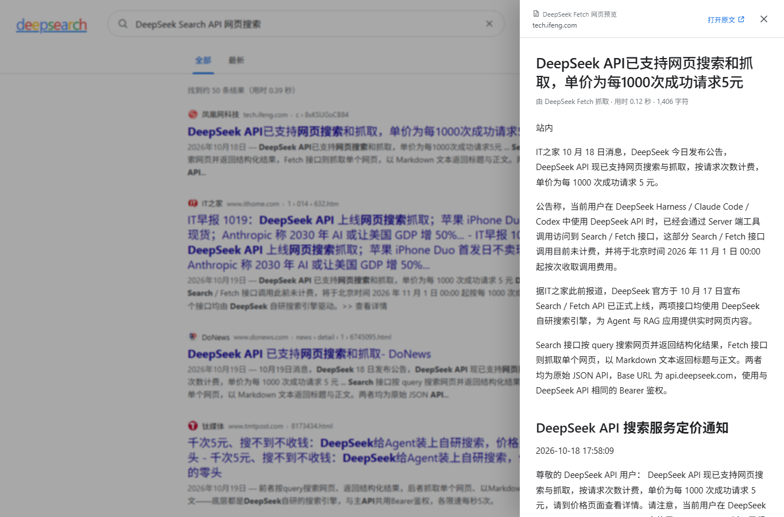

# deepsearch

一个本地运行的 Google 风格搜索页面，后端调用 DeepSeek 的 **Search API** 与 **Fetch API**。没有前端框架、没有第三方运行时依赖，Node.js 直接启动。
适合作为百度、bing 的替代品，干净无广告，完全按照匹配度排名。


## 功能

- Google 风格的首页、搜索框、结果页、站点信息、标题、摘要与分页
- 后端代理 DeepSeek Search API，API Key 不会进入浏览器
- 点击结果右侧的「预览」，通过 DeepSeek Fetch API 在侧边抽屉中阅读网页正文
- 「全部 / 最新」切换；「最新」按网页发布日期倒序排列
- 单次请求最多获取 50 条结果，前端每页显示 10 条并本地分页
- 支持 `site:`、`-site:`、`lang:`、`after:`、`before:`、`"精确短语"`、`-排除词` 等查询语法
- 搜索词组在标题与摘要中加粗高亮
- 最近 5 分钟内的相同查询会复用浏览器内存缓存，翻页不额外调用 API
- 浅色 / 深色主题、响应式布局、键盘 `/` 聚焦搜索框、`Esc` 关闭预览
- 本地只监听 `127.0.0.1`，并设置了 CSP、点击劫持和 MIME 嗅探防护
- Fetch 返回的 Markdown 通过安全的 DOM 构造方式渲染，不执行网页里的脚本



## 快速开始

要求 Node.js 20 或更高版本。

```bash
cd D:/OneDrive/Software/deepseek-search
cp .env.example .env
```

编辑 `.env`，填入 DeepSeek API Key：

```dotenv
DEEPSEEK_API_KEY=sk-你的密钥
```

然后启动：

```bash
npm start
```

打开 <http://127.0.0.1:3000>。

Windows 下也可以复制配置文件：

```bat
copy .env.example .env
notepad .env
npm start
```

API Key 在 [DeepSeek 开放平台](https://platform.deepseek.com/api_keys) 创建。

## 配置

| 变量 | 默认值 | 说明 |
| --- | --- | --- |
| `DEEPSEEK_API_KEY` | 空 | 必填。只在本地服务端读取，不会返回给前端 |
| `PORT` | `3000` | 本地 HTTP 端口 |
| `HOST` | `127.0.0.1` | 监听地址。除非明确需要局域网访问，否则不要改成 `0.0.0.0` |
| `DEEPSEEK_API_BASE` | `https://api.deepseek.com` | API 基础地址，仅用于测试 mock |

修改 `.env` 后需要重启 `npm start` 才会生效。

## 工作方式

```text
浏览器
  ├── POST /api/search  ──► Node 本地服务 ──► POST https://api.deepseek.com/v1/tools/search
  └── POST /api/fetch   ──► Node 本地服务 ──► POST https://api.deepseek.com/v1/tools/fetch
```

- `/api/search` 校验参数后请求 DeepSeek Search API，返回 `results`、总数和耗时。
- `/api/fetch` 校验 URL（仅 http/https、禁止内嵌账号密码），再请求 DeepSeek Fetch API，把 Markdown 正文返回给预览抽屉。
- 页面本身由同一个 Node 进程作为静态文件提供，无需单独的前端服务器。
- DeepSeek Search API 对每次成功请求计费，与 `count` 和返回条数无关，因此本项目一次取 50 条、前端分页，减少重复请求。
- 服务端对 408 / 429 / 5xx 自动退避重试，最多 3 次。

## 测试

```bash
npm test
```

11 项测试覆盖：

- 查询参数和 URL 校验
- Search / Fetch 对上游 API 的代理、鉴权头和请求体
- 空结果、缺少 API Key、无效 URL 的处理
- 静态页面与安全响应头
- 路径穿越防护

测试使用进程内的 mock 上游，不消耗 DeepSeek 额度。`tools/mock-deepseek.js` 还可用于本地 UI 调试：

```bash
# 终端 1
node tools/mock-deepseek.js

# 终端 2
DEEPSEEK_API_KEY=mock DEEPSEEK_API_BASE=http://127.0.0.1:4100 PORT=3100 npm start
```

然后打开 <http://127.0.0.1:3100>。

## 限制

- DeepSeek Search API 目前不提供游标或页码，因此只使用单次返回的前 50 条结果做本地分页。
- 「最新」是客户端按 `date` 字段排序，不是服务端的新鲜度筛选；无发布日期的结果排在后面。
- 页面会过滤掉非 http/https 的结果 URL；Fetch 预览只展示 DeepSeek 返回的 Markdown 正文，原始网页样式和图片不会完整还原。
- 单次 Fetch 正文最多保留 500,000 字符，页面渲染最多 250,000 字符。
- API 价格与限流以官方文档为准：Search / Fetch 当前均为每 1,000 次成功请求 $0.75；失败、空结果和超时不计费。

## 官方文档

- [DeepSeek Search & Fetch 指南（英文）](https://api-docs.deepseek.com/guides/search/)
- [网页搜索与抓取（中文）](https://api-docs.deepseek.com/zh-cn/guides/search/)
- [DeepSeek 开放平台](https://platform.deepseek.com/)
